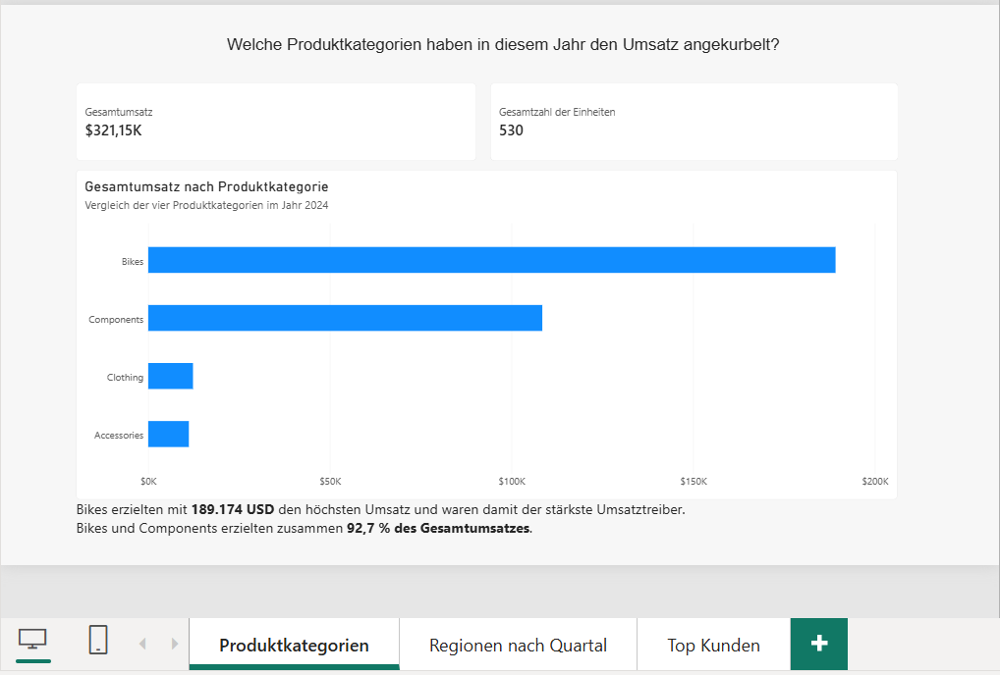
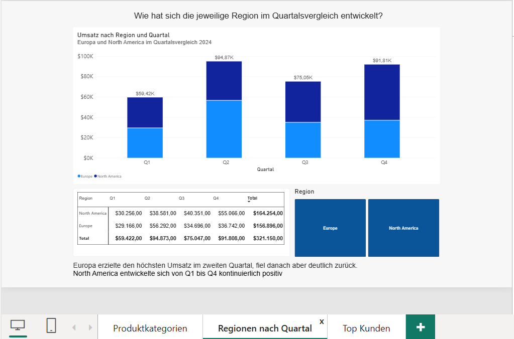
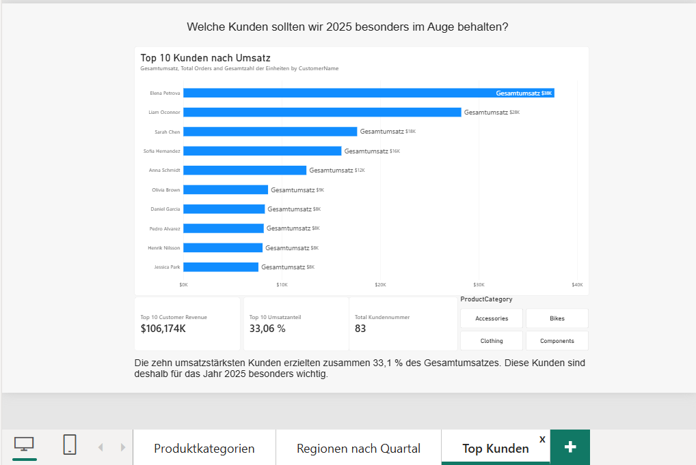

# PeakFlow – Online Orders 2024

**Power-BI-Abschlussprojekt · Power Query · Sternschema · DAX · Reporting**

In diesem Projekt bereite ich fehlerhafte Online-Bestelldaten auf und entwickle einen Power-BI-Bericht für die Planung 2025. Der Schwerpunkt liegt auf nachvollziehbarer Datenbereinigung, einem klaren Datenmodell und der Beantwortung konkreter Geschäftsfragen.

Aus **320 Rohdatenzeilen** entstehen **305 eindeutige Bestellungen** mit einem Gesamtumsatz von **321.150 USD**.

## Geschäftsfragen

1. Welche Produktkategorien haben 2024 den Umsatz angetrieben?
2. Wie haben sich die Regionen im Quartalsvergleich entwickelt?
3. Welche Kunden sollten für die Planung 2025 besonders berücksichtigt werden?

## Ergebnisse auf einen Blick

Die Werte beziehen sich auf den bereinigten Datenbestand 2024 ohne zusätzliche Einschränkung auf einzelne Kunden, Regionen oder Kategorien.

| Kennzahl | Ergebnis |
| --- | ---: |
| Gesamtumsatz | 321.150,00 USD |
| Gültige Bestellungen | 305 |
| Verkaufte Einheiten | 530 |
| Durchschnittlicher Bestellwert | 1.052,95 USD |
| Eindeutige Kunden-IDs | 83 |
| Produktkategorien / Regionen | 4 / 2 |

**Produktkategorien:** Bikes erzielen 189.174 USD und damit 58,91 % des Umsatzes. Zusammen mit Components entfallen 92,68 % des Gesamtumsatzes auf diese beiden Kategorien.

**Regionen:** North America erreicht 164.254 USD und steigert den Umsatz in jedem Quartal – von 30.256 USD in Q1 auf 55.066 USD in Q4. Europe erzielt 156.896 USD; das stärkste Quartal ist Q2 mit 56.292 USD.

**Kundenkonzentration:** Die zehn umsatzstärksten Kunden-IDs stehen für 106.174 USD beziehungsweise 33,06 % des Gesamtumsatzes. Die umsatzstärkste Kunden-ID ist C-0007 mit 15.567 USD.

Für die Planung ergeben sich daraus Ansatzpunkte für die Sortimentsanalyse, die Untersuchung regionaler Entwicklungen und die gezielte Betreuung umsatzstarker Kunden. Die Analyse beschreibt 2024 und stellt keine Prognose für 2025 dar.

## Datenbasis und Bereinigung

Die bereitgestellte Projektdatei `peakflow_online_orders_dirty.csv` enthält **320 Zeilen und 12 Spalten**. Erfasst sind Bestellungen, Kunden, Regionen, Produkte, Mengen, Einzelpreise in USD und der Vertriebskanal.

Die Bereinigung erfolgt in **Power Query**. Die ursprüngliche CSV bleibt unverändert; die Transformationen sind als angewandte Schritte dokumentiert.

- Den konstanten Vertriebskanal `Channel` entfernen.
- Textfelder trimmen und E-Mail-Adressen vereinheitlichen.
- Regionen auf `North America` und `Europe` standardisieren.
- Kategorien und Tippfehler auf `Bikes`, `Components`, `Clothing` und `Accessories` vereinheitlichen.
- Dollarzeichen und Tausendertrennzeichen aus Preisen entfernen und numerische Datentypen festlegen.
- Die vier Datumsformate explizit interpretieren: `YYYY-MM-DD`, `MM/DD/YYYY`, `DD-MM-YYYY` und ausgeschriebene englische Datumswerte.
- Vier Zeilen mit nicht positiver Menge und drei Zeilen ohne Preis ausschließen.
- Drei fehlende Kunden-IDs anhand der im Projektdatensatz enthaltenen E-Mail-Kennung ergänzen.
- Abschließend acht doppelte Zeilen anhand von `OrderID` entfernen.

**Kontrollrechnung:** 320 − 4 − 3 − 8 = **305 Bestellungen**.

## Datenmodell

Das Modell folgt einem **Sternschema**. Eine Zeile in `FactOrders` entspricht einer eindeutigen Bestellung mit Produkt, Menge und Bestellpreis.

| Dimension | Beziehung zu FactOrders | Analysefunktion |
| --- | --- | --- |
| `DimProduct` | `ProductSKU` → `ProductSKU` | Produkte und Kategorien |
| `DimCustomer` | `CustomerID` → `CustomerID` | Kunden und Regionen |
| `DimDate` | `OrderDate` → `OrderDate` | Zeitliche Auswertung |

Alle drei Beziehungen sind **1:*** mit einseitiger Filterrichtung von der Dimension zur Faktentabelle.

Kunden werden über ihre ID ausgewertet. Namen sind kein eindeutiger Schlüssel: Im bereinigten Datensatz stehen 83 Kunden-IDs nur 16 unterschiedlichen Namen gegenüber.

## Zentrale DAX-Berechnungen

Die folgenden Definitionen entsprechen der Begleitdokumentation. Jedes Measure wird einzeln angelegt.

```dax
Gesamtumsatz =
SUMX(
    FactOrders,
    FactOrders[Quantity] * FactOrders[UnitPriceUSD]
)
```

```dax
Gesamtzahl der Einheiten =
SUM(FactOrders[Quantity])
```

```dax
Mittelwert der Bestellungen =
DIVIDE(
    [Gesamtumsatz],
    COUNTROWS(FactOrders),
    0
)
```

```dax
Total Kundennummer =
DISTINCTCOUNT(FactOrders[CustomerID])
```

Der Umsatz wird je Bestellung als **Menge × Einzelpreis** berechnet und anschließend summiert. Der durchschnittliche Bestellwert verwendet die Anzahl der Bestellungen als Nenner.

Zusätzlich ordnet die berechnete Spalte `Umsatzstufe` jede Bestellung einer festen Umsatzklasse zu. Sie kann zur Gruppierung und Filterung verwendet werden.

## Berichtsseiten und Filter

| Seite | Visualisierungen | Zweck |
| --- | --- | --- |
| Umsatz nach Produktkategorie | Balkendiagramm, KPI-Karten für Umsatz und Einheiten | Umsatzbeiträge der vier Kategorien vergleichen |
| Umsatz nach Region und Quartal | Matrix mit Regionen als Zeilen und Quartalen als Spalten | Regionale Entwicklung im Jahresverlauf vergleichen |
| Top-Kunden für 2025 | Balkendiagramm und KPI-Karte zum Umsatzanteil der Top 10 | Umsatzkonzentration auf Kunden-IDs untersuchen |

Auf der Kundenseite begrenzt ein **Top-N-Filter auf die zehn Kunden nach Gesamtumsatz** das Kundenvisual. Der dokumentierte Anteil von 33,06 % setzt deren Umsatz ins Verhältnis zum gesamten bereinigten Jahresumsatz.

Die Ausschlüsse ungültiger Zeilen erfolgen bereits in Power Query. Diese Bereinigungsregeln sind von den Filtern der Berichtsvisualisierungen zu unterscheiden.

## Projektdateien und Reproduktion

| Datei | Inhalt |
| --- | --- |
| Power-BI-Projektdatei (`.pbix`) | Bericht, Datenmodell und hinterlegte Transformationen |
| `peakflow_online_orders_dirty.csv` | Unveränderte Ausgangsdaten |
| `PeakFlow_Begleitdokumentation_Suryandi_Suryandi.pdf` | Inspektion, Transformation, Modellierung, Measures und Ergebnisinterpretation |

1. Die PBIX-Datei in **Power BI Desktop** öffnen.
2. Für eine erneute Datenaktualisierung die CSV lokal bereitstellen und den Quellpfad in Power Query auf diese Datei anpassen.
3. Die dokumentierten Transformationen anwenden und die Daten aktualisieren.
4. Die Kontrollwerte prüfen: **305 Bestellungen, 530 Einheiten, 83 Kunden-IDs und 321.150 USD Umsatz**.
5. Die drei Berichtsseiten mit den Ergebnissen der Begleitdokumentation abgleichen.

Für die lokale Arbeit mit Power BI Desktop ist keine Anmeldung beim Power-BI-Service erforderlich; siehe [Microsoft Press: Power BI Desktop einrichten](https://www.microsoftpressstore.com/articles/article.aspx?p=3222429&seqNum=2).

## Berichtsvorschau

Der Power-BI-Bericht umfasst drei Seiten zur Analyse der Onlinebestellungen 2024.

### 1. Umsatz nach Produktkategorie

Vergleich der Umsatzbeiträge von Bikes, Components, Clothing und Accessories. Ergänzende KPI-Karten zeigen den Gesamtumsatz und die verkauften Einheiten.



### 2. Umsatz nach Region und Quartal

Die Matrix vergleicht die Umsätze von Europe und North America über die vier Quartale. Dadurch werden regionale Unterschiede und Entwicklungen im Jahresverlauf sichtbar.



### 3. Top-Kunden für die Planung 2025

Darstellung der zehn umsatzstärksten Kunden-IDs aus 2024 und ihres gemeinsamen Anteils am Gesamtumsatz. Die Ergebnisse liefern Ansatzpunkte für die Kundenbetreuung und Planung 2025.



## Einordnung und Grenzen

- **Zeit und Umfang:** Die Analyse umfasst die bereitgestellten Onlinebestellungen aus 2024. Aussagen über andere Jahre oder Vertriebskanäle lassen sich daraus nicht ableiten.
- **Negative Mengen:** Diese Zeilen wurden gemäß Projektregel ausgeschlossen. Für einen realen Anwendungsfall wäre zu prüfen, ob sie Retouren darstellen und separat ausgewertet werden müssen.
- **Fehlende Preise:** Drei Bestellungen wurden ausgeschlossen. Die Umsatzkennzahlen beziehen sich daher auf den bereinigten Datenbestand.
- **Kundenidentität:** 83 eindeutige IDs entsprechen 83 unterscheidbaren Kennungen im Datensatz; sie belegen nicht automatisch 83 unterschiedliche Personen.
- **Wirtschaftliche Bewertung:** Umsatz ist keine Aussage über Gewinn oder Marge. Kosteninformationen fehlen in der Ausgangsdatei.
- **Ergebnisstand:** Die beschriebenen Modell- und Berichtsmerkmale basieren auf der Begleitdokumentation. Die zentralen Kennzahlen wurden zusätzlich aus der zugehörigen CSV nachvollzogen.

## Autor

**Suryandi Suryandi**  
Abschlussprojekt im Rahmen der Weiterbildung zum Data Analyst.

